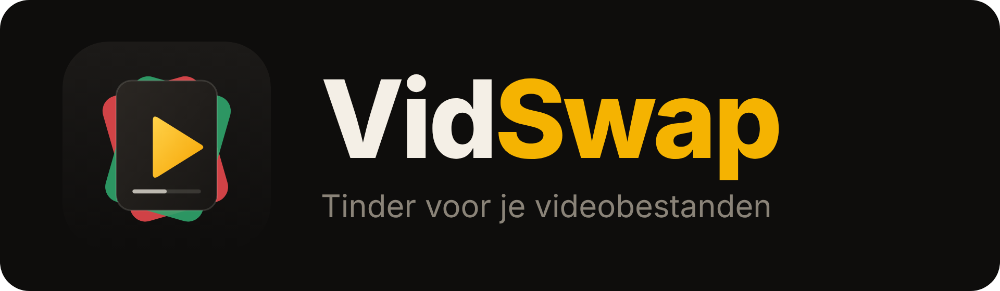

<p align="center">
  
</p>

Sorteer je videobestanden zoals je swipet op Tinder. VidSwap draait als kleine container op je NAS, speelt je video's willekeurig en automatisch af, en verplaatst ze met één swipe naar de juiste map.

- **Geen dependencies**: één Node.js-bestand en één HTML-pagina, geen build-stap.
- **Werkt op telefoon én desktop**: swipen met vinger of muis, of met de pijltjestoetsen.
- **Snel en veilig**: verplaatsen binnen dezelfde share is instant, bestanden worden nooit overschreven en nooit buiten de videomap aangeraakt.

## Bediening

| Swipe | Toets | Actie |
|:-----:|:-----:|-------|
| ← links | `←` | Verplaatsen naar `_prullenbak` |
| → rechts | `→` | Verplaatsen naar `_behouden` |
| ↑ omhoog | `↑` | Verplaatsen naar `_favorieten` |
| ↓ omlaag | `↓` | Negeren (alleen deze sessie overslaan) |

### Afspelen en hernoemen

Video's starten gedempt (browsers staan geen geluid toe voor je iets hebt aangetikt) en herhalen tot je swipet. Onder elke video staan:

- **Voortgangsbalk**: tik of sleep om door te spoelen.
- **10 s terug / vooruit** en **pauze / afspelen**. Een tik op de video pauzeert ook.
- **Geluidsknop**: zet het geluid aan of uit. Je keuze wordt onthouden in je browser.
- **Potlood**: wijzig de bestandsnaam. De extensie blijft behouden, het bestand blijft in dezelfde map en bestaande bestanden worden nooit overschreven.

| Toets | Actie |
|:-----:|-------|
| `spatie` / `K` | Pauze of afspelen |
| `M` | Geluid aan of uit |
| `J` / `L` | 10 seconden terug / vooruit |
| `F2` / `R` | Naam wijzigen (`Enter` bewaart, `Esc` annuleert) |

## Mappenstructuur

Alles gebeurt binnen één map op je NAS, bijvoorbeeld `/volume1/map1/map2`:

```
map2/
├── ...jouw video's (ook in submappen)...
├── _prullenbak/            ← swipe links, wordt automatisch aangemaakt
├── _favorieten/            ← swipe omhoog, wordt automatisch aangemaakt
└── _behouden/              ← swipe rechts, wordt automatisch aangemaakt
```

De mappen `_prullenbak`, `_favorieten` en `_behouden`, verborgen mappen en Synology's `@eaDir` worden niet meegenomen bij het afspelen. Naamconflicten worden opgelost door een tijdstempel aan de bestandsnaam toe te voegen. De prullenbak wordt **niet** automatisch geleegd, dat doe je zelf wanneer je zeker bent.

> **Upgraden vanaf een eerdere versie:** video's die je eerder had behouden stonden in een verborgen lijst (`.vidswap-kept.json`). Bij de eerste start worden die bestanden eenmalig naar `_behouden` verplaatst en wordt de lijst hernoemd naar `.vidswap-kept.json.migrated`.

Ondersteunde formaten: `mp4`, `m4v`, `webm`, `mov`, `mkv`, `ogv` (afspelen hangt af van wat je browser ondersteunt).

## Installeren op Synology

Je hoeft de repository niet naar de NAS te kopiëren. GitHub bouwt het image automatisch (`.github/workflows/docker-image.yml`) en zet het op `ghcr.io`; de NAS haalt het zelf op.

**Eenmalig op GitHub**
1. Push deze repository naar [github.com/bigbuud/VidSwap](https://github.com/bigbuud/VidSwap) (branch `main`). De workflow start vanzelf en publiceert `ghcr.io/bigbuud/vidswap:latest`.
2. Is de repository privé? Zet dan het package op publiek (GitHub → je profiel → *Packages* → `vidswap` → *Package settings* → *Change visibility*), of log op de NAS in met `docker login ghcr.io` en een token met `read:packages`.

**Op de NAS**
1. Open **Container Manager** → *Project* → *Aanmaken*, geef het project de naam `vidswap` en kies *docker-compose.yml aanmaken*.
2. Plak de inhoud van [`docker-compose.yml`](docker-compose.yml). Controleer het pad naar je videomap (standaard `/volume1/map1/map2`).
3. Start het project en open `http://<nas-ip>:8085`.

Via SSH kan ook: `sudo docker compose up -d` in de map met je compose-bestand.

**Updaten:** na een push naar `main` is het nieuwe image binnen enkele minuten klaar. Op de NAS: Container Manager → Project → *Actie* → *Opnieuw opbouwen* (of `sudo docker compose pull && sudo docker compose up -d`).

> Liever zonder GitHub Actions? Vervang in de compose de `image:`-regel door `build: https://github.com/bigbuud/VidSwap.git#main`, dan bouwt de NAS het image zelf rechtstreeks uit git.

> De container draait als UID `1026` / GID `100`. Die gebruiker heeft lees- en schrijfrechten nodig op de videomap (Configuratiescherm → Gedeelde map → Bewerken → Machtigingen).

Tip: voeg de pagina toe aan je beginscherm op je telefoon, dan opent VidSwap als een app.

## Instellingen

Rechtstreeks in `docker-compose.yml` aanpassen, of via een `.env`-bestand naast de compose (zie `.env.example`):

| Variabele | Standaard | Omschrijving |
|-----------|-----------|--------------|
| `VIDEO_PATH` | `/volume1/map1/map2` | Map op de NAS met je video's |
| `PUID` / `PGID` | `1026` / `100` | Gebruiker en groep waaronder de container draait |
| `PORT` | `8085` | Poort waarop je de app opent |
| `TRASH_FOLDER` | `_prullenbak` | Map voor weggegooide video's, relatief aan `VIDEO_PATH` |
| `FAV_FOLDER` | `_favorieten` | Map voor favorieten, relatief aan `VIDEO_PATH` |
| `KEEP_FOLDER` | `_behouden` | Map voor behouden video's, relatief aan `VIDEO_PATH` |

De server zelf (`server/server.mjs`) leest daarnaast `VIDEO_DIR`, `TRASH_DIR`, `FAV_DIR`, `KEEP_DIR` en `PORT` uit de omgeving.

## Lokaal draaien (zonder Docker)

Vereist Node.js 20 of nieuwer.

```sh
cd server
VIDEO_DIR=/pad/naar/testvideos PORT=8080 node server.mjs
# open http://localhost:8080
```

## Projectopbouw

```
.
├── server/
│   ├── server.mjs          # HTTP-server: video's lijst, streamen (Range), acties
│   └── public/             # de app (index.html), logo, icons en manifest
├── docs/banner.png
├── .github/workflows/docker-image.yml   # bouwt en publiceert het image
├── Dockerfile
├── docker-compose.yml
└── .env.example
```

## API

| Route | Omschrijving |
|-------|--------------|
| `GET /api/videos` | Willekeurig geschudde lijst van nog te sorteren video's |
| `POST /api/action` | `{ "file": "pad/naar.mp4", "action": "trash" \| "favorite" \| "keep" \| "rename", "newName": "..." }` |
| `GET /video?f=pad/naar.mp4` | Stream met ondersteuning voor spoelen |
| `GET /healthz` | Healthcheck |

> **Let op:** de app heeft geen inlog. Zet hem alleen op je eigen netwerk, of achter een reverse proxy met authenticatie, als je hem buiten je thuisnetwerk wilt gebruiken.
